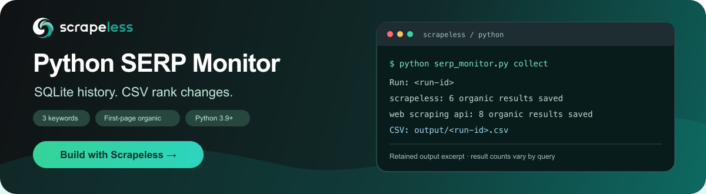
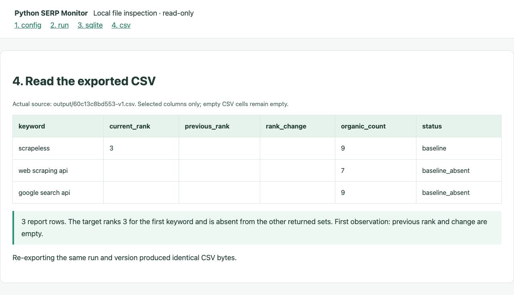
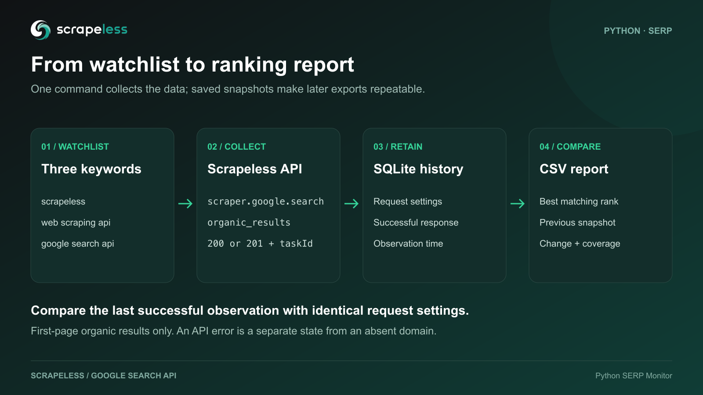

<p align="center">
  <a href="https://app.scrapeless.com/passport/login?redirect=%2Fquick-start&amp;utm_source=github&amp;utm_medium=referral&amp;utm_campaign=scrapeless-python-serp-monitor&amp;utm_content=repository-readme"></a>
</p>

# Scrapeless Python SERP Monitor

<p align="center">
  <a href="https://app.scrapeless.com/passport/login?redirect=%2Fquick-start&amp;utm_source=github&amp;utm_medium=referral&amp;utm_campaign=scrapeless-python-serp-monitor&amp;utm_content=repository-readme"></a>
  <a href="https://www.scrapeless.com/en/blog?utm_source=github&amp;utm_medium=referral&amp;utm_campaign=scrapeless-python-serp-monitor&amp;utm_content=repository-readme"></a>
  <a href="https://x.com/Scrapelessteam?utm_source=github&amp;utm_medium=referral&amp;utm_campaign=scrapeless-python-serp-monitor&amp;utm_content=repository-readme"></a>
  <a href="https://www.linkedin.com/company/scrapeless/?utm_source=github&amp;utm_medium=referral&amp;utm_campaign=scrapeless-python-serp-monitor&amp;utm_content=repository-readme"></a>
</p>

Track Google organic keyword positions, retain SQLite snapshots, and export ranking-change CSVs with Python and Scrapeless.

**[Get your Scrapeless API key with $5 Free credits!](https://app.scrapeless.com/passport/login?redirect=%2Fquick-start&utm_source=github&utm_medium=referral&utm_campaign=scrapeless-python-serp-monitor&utm_content=repository-readme)**

- **Documentation:** [Google Search API quickstart](https://docs.scrapeless.com/en/docs/scraping-api/google-search/quickstart/?utm_source=github&utm_medium=referral&utm_campaign=scrapeless-python-serp-monitor&utm_content=repository-readme)
- **Command help:** `python3 serp_monitor.py --help`

Keep a small keyword watchlist and answer: which positions changed since the last successful observation under the same search conditions?

| Command | Purpose | Makes search requests |
| --- | --- | --- |
| `tutorial.py` | Open the local beginner page | Only after clicking Run |
| `collect` | Save keyword snapshots and write a comparison CSV | Yes |
| `history` | List saved runs | No |
| `export` | Read an immutable saved report version | No |
| `demo` | Try two synthetic rounds without a key | No |

## Quick start

Requires **Python 3.9+ on macOS or Linux**, SQLite support and a Scrapeless API key with available credits. The project uses the Python standard library and POSIX file locks.

### 1. Download the project

On this repository page, select **Code > Download ZIP**, extract the archive, and open the extracted project folder in your terminal. The default archive folder is `scrapeless-python-serp-monitor-main`; use the actual folder name if it differs:

```bash
cd ~/Downloads/scrapeless-python-serp-monitor-main
```

Confirm that `serp_monitor.py`, `tutorial.py`, `starter.html`, and `config.json` are present. Run subsequent commands from this directory. No third-party Python package installation or separate database server is required. Check the environment with `python3 --version` and `python3 -c "import sqlite3, ssl, fcntl; print('Environment check: OK')"`.

### 2. Configure the API key and watchlist

Get your shared key from the [Scrapeless dashboard](https://app.scrapeless.com/passport/login?utm_source=github&utm_medium=referral&utm_campaign=scrapeless-python-serp-monitor&utm_content=repository-readme). Create a private configuration file without overwriting an existing one:

```bash
cp -n .env.example .env
chmod 600 .env
```

On macOS, open the file with `open -e .env`. On Linux, open it in your plain-text editor. Replace the placeholder, save as `.env` rather than `.env.txt`, and close the editor:

```dotenv
SCRAPELESS_API_KEY=YOUR_SCRAPELESS_API_KEY
```

Open `config.json` in the same plain-text editor (`open -e config.json` on macOS). Save your changes without changing the filename. The included file checks three keywords for one target domain:

```json
{
  "keywords": ["scrapeless", "web scraping api", "google search api"],
  "target_domains": ["scrapeless.com"],
  "gl": "us",
  "hl": "en",
  "google_domain": "google.com",
  "location": "Austin, Texas, United States"
}
```

Use your own authorized keywords and target domain. Keep the same search conditions and database when you want to compare later observations. An existing `SCRAPELESS_API_KEY` environment variable takes precedence over `.env`.

### 3. Collect, inspect and export

```bash
python3 serp_monitor.py collect --config config.json --env-file .env
python3 serp_monitor.py history --db data/rankings.sqlite
python3 serp_monitor.py export --output output/saved-report.csv
```

`collect` submits real searches and uses account credits. `history` reads saved runs, and `export` reads a saved report version without requesting new results. For the supplied watchlist, a fresh collection submits up to three searches.

Results are saved in `data/rankings.sqlite` and `output/<run-id>-v1.csv`. Keep the database for later comparisons. The first successful run creates a baseline; subsequent comparable observations can produce ranking changes. Actual ranks and returned counts vary.

### 4. Optional local interface or offline demo

The command-line workflow above is complete. If you prefer a form, run the following **on your own computer, from the downloaded project folder**:

```bash
python3 tutorial.py
```

Keep that process running and open the loopback address printed in your terminal (by default, `http://127.0.0.1:8791/`). This interface runs on your computer; it is not a hosted Scrapeless website or a shared public link. It is unavailable until the local process starts. Save the key and watchlist, then click **Run once** to submit searches. Closing the process stops the interface. The same collector, history and report rules apply to both interfaces.

To try two clearly synthetic rounds without a key or API calls:

```bash
python3 serp_monitor.py demo
```

This writes `output/demo/round-1.csv` and `round-2.csv`, separate from live history. Real collection still requires your own Scrapeless key and available credits.

## Configuration

| Field | Default | Meaning |
| --- | --- | --- |
| `keywords` | Required; three supplied | Nonempty list of unique search queries |
| `target_domains` | Required; one supplied | Unique hostnames, without schemes or paths |
| `gl` | `us` | Search country |
| `hl` | `en` | Search language |
| `google_domain` | `google.com` | Search domain |
| `location` | Optional; Austin supplied | Search location; omit to use service defaults |

An existing `SCRAPELESS_API_KEY` environment variable takes precedence over `.env`, including when the local form saved a different key. The file loader reads only that variable and does not execute shell expressions. Use `--env-file` for a different local file.

A target such as `example.com` includes `www.example.com` and other subdomains, but excludes `notexample.com` and `example.com.other.org`. When several URLs match, the lowest returned `position` is used. Each target domain gets a separate report row.

Comparisons require identical request inputs and the same live/demo mode. Changing inputs starts a separate series. Daily operation requires explicit `gl`, `hl`, `google_domain` and `location`. Missing or malformed responses and unconfirmed empty arrays never enter ranking baselines. Search scope is desktop, first returned organic page; result count is not guaranteed.

## Usage

### Choose database and report paths

```bash
python3 serp_monitor.py collect --config config.json \
  --db data/rankings.sqlite --output output/latest.csv
```

Keep the database between runs. It contains the history and pending-task information; a CSV alone cannot restore it.

### Inspect history or export again

```bash
python3 serp_monitor.py history --db data/rankings.sqlite
python3 serp_monitor.py export --output output/latest.csv
python3 serp_monitor.py export --run-id YOUR_RUN_ID --output output/saved-run.csv
```

`history` and `export` make no API calls. Completed report rows and baseline IDs are stored, including an explicitly empty baseline. Later collections and old-run resumes cannot change a saved version. Resume may create a new version of a partial report; older versions remain readable. Export defaults to the latest version of the selected run.

```bash
python3 serp_monitor.py export --run-id YOUR_RUN_ID --version 1 --output output/saved-v1.csv
```

### Resume a pending run

```bash
python3 serp_monitor.py collect --resume YOUR_RUN_ID --db data/rankings.sqlite
```

Resume uses saved request settings and task IDs. Successful keywords are skipped, existing tasks are polled, and never-submitted keywords may be submitted. A request with an uncertain outcome and no saved task ID is not reposted automatically. Investigate it before deliberately starting a new run.

```bash
python3 serp_monitor.py collect --timeout 60 --poll-timeout 180 --poll-interval 3
```

Defaults are 60 seconds per request, 120 seconds for each polling window, and 2 seconds between normal polls. See `docs/cli.md` for every option and default.

## CSV output

Reports are UTF-8 CSVs with a byte-order mark. Alongside positions, URLs, coverage and errors, they include snapshot IDs, the frozen baseline ID, report version/state, request submission and result receipt timestamps. `captured_at` is a compatibility alias for receipt time; no provider collection timestamp is claimed. Formula-like text cells are escaped.

```text
rank_change = previous_rank - current_rank
```

Positive means improvement; negative means decline. When either rank is absent, the numeric change stays blank. Blank does not mean position zero or position 100.

| Status | Interpretation |
| --- | --- |
| `baseline` / `baseline_absent` | First comparable success, with / without a domain match |
| `up` / `down` / `unchanged` | Both observations matched; compare their positions |
| `new` / `lost` | Match observed only now / only previously |
| `still_absent` | No match in either returned result set |
| `pending` / `error` | Incomplete or failed collection; no absence conclusion |
| `empty_unverified` | Entire organic array empty; excluded from ranking baselines |
| `not_comparable` | Valid result but collection order unknown or overlapping; no change calculated |

Live run `60c13c8bd553`, observed October 29, 2026, produced this first-baseline report:

| Keyword | Previous | Current | Change | Status | Returned count |
| --- | --- | --- | --- | --- | --- |
| `scrapeless` | blank | 3 | blank | `baseline` | 9 |
| `web scraping api` | blank | blank | blank | `baseline_absent` | 7 |
| `google search api` | blank | blank | blank | `baseline_absent` | 9 |

The three keyword collections succeeded and produced one run, three SQLite snapshots and three CSV rows. Re-exporting version 1 produced identical CSV bytes. See `examples/live-current.csv`, `examples/live-current.summary.json` and `docs/output.md`.



*Read-only browser view of selected columns from the actual CSV, not a spreadsheet application screenshot. Blank fields remain blank. Search results can vary.*

## How it works



1. Submit `scraper.google.search` for each configured keyword.
2. Resolve recognized Google redirect links, then validate every returned organic item; never silently drop unresolved rows.
3. Retain request settings and response JSON in SQLite.
4. Freeze a baseline whose result was received before the current request began. Overlapping or unknown intervals are not compared.
5. Store immutable report versions, including incomplete and data-quality states.

Google `/goto` and `/url` wrappers are resolved through Google Location headers or explicit plain-text targets. Those lookups carry no API key and never visit the destination website. Failures remain errors. HTTP `200` returns completed results. HTTP `201` provides a `taskId`, saved before polling the existing task. The monitor requests first-page desktop organic web results with `start: 0`; it does not paginate or combine ads, maps and AI citations into one ranking. See `docs/api-notes.md`.

## Troubleshooting

| Symptom | Action |
| --- | --- |
| Missing key / HTTP 401 | Replace the placeholder and check environment-variable precedence |
| HTTP 402 / 403 | Check balance and product access in the dashboard |
| HTTP 429 | Reduce collection frequency; wait before resuming queued work |
| HTTP 500 | Investigate before starting a new search; existing-task polling backs off for up to a minute |
| Polling timeout | Keep the database and use the printed run ID with `collect --resume` |
| Google redirect could not be resolved | Keep the error report; no destination is guessed and no new search is automatically retried |
| Missing `organic_results` | Inspect the response or contact support; unusable data is an error |
| Blank rank / unexpected baseline | Check target hostname, returned coverage, search inputs, and database path |
| `empty_unverified` | Review response quality; do not treat it as a lost ranking or blindly retry |
| `not_comparable` | Check request intervals and migration notes; no direction is calculated |
| Busy, exit 75 | Let the active process finish; scheduled and manual runs share this protection |

HTTP `401`, `402`, `403` and `429` stop the batch before remaining keywords are submitted. Other keyword failures are recorded while the batch continues. Exit codes: `0` for success, `1` for incomplete or failed work, `75` for a busy database, `130` for interruption. All collection entry points share the same database lock. The OS releases it after process death; do not delete the lock sidecar. Use local storage, not a network-shared database.

## Optional daily workflow

Use the same absolute database and artifact paths across executions. The wrapper uses the core lock and report versions:

```bash
python3 daily_workflow.py run --config "$PWD/config.json" --env-file "$PWD/.env" \
  --db "$PWD/data/rankings.sqlite" --artifacts "$PWD/output/daily"
```

Read `output/daily/latest-attempt.json` first, then its summary and CSV. Each attempt writes a human-readable summary, a JSON summary and a review CSV under `runs/<run-id>/`. Review reasons include declines, landing-page changes, missing targets, coverage changes and data-quality problems. A failed attempt leaves `latest-success.json` pointing to the previous successful collection; it is not the current attempt. A successful collection can still contain review items or `not_comparable` rows.

For scheduling, backup and a step-by-step recovery table, read `docs/operations.md`. The macOS example checks a configured UTC daily slot once per minute. Rendering the example does not activate it. A slot is attempted at most once per date, including failed or interrupted attempts; investigate and explicitly resume saved work. Use one configuration and artifact directory per database.

Request volume is keywords times new-run frequency, plus never-submitted queued keywords resumed later. Multiple target domains reuse each keyword response. Result GET polls are counted separately; this is not a verified billing estimate.

The live example in this guide covers one collection. For recurring use, verify the schedule and review thresholds against your own saved history. Read the validation scope below.

## Database upgrades

Opening an older database automatically creates a private `.pre-v2.sqlite` backup and migrates schema version 2 without deleting runs or raw historical data. Legacy request submission times are unknown; historical change directions are not reconstructed. Keep the archived CSVs and follow the instructions in `docs/migration.md` before using an existing database.

## Development

```bash
python3 -m unittest discover -s tests -v
python3 serp_monitor.py demo
```

Run development checks from the full downloaded repository. The tests and synthetic demo need no API key. The supplied Actions workflow checks Python 3.9 and 3.13. Read `CONTRIBUTING.md` and the validation scope below.

## Validation scope

The included live CSV is a first-baseline example, not evidence of a multi-day ranking trend. Its matching URL paths are generalized; ranks, counts, states, and request timestamps are preserved. The automated tests and synthetic demo make no paid service requests and do not establish continuous live operation, machine-reboot recovery, or consecutive multi-day schedule reliability.

The local browser interface runs on the user's computer. It is not a hosted website. The CSV figure is a read-only browser view of selected actual output fields, not a spreadsheet application screenshot.

## Related projects

- [Scrapeless Google Search API](https://docs.scrapeless.com/en/docs/scraping-api/google-search/quickstart/?utm_source=github&utm_medium=referral&utm_campaign=scrapeless-python-serp-monitor&utm_content=repository-readme) - API examples for search workflows.
- [Scrapeless CLI](https://docs.scrapeless.com/en/docs/developer-tools/cli/?utm_source=github&utm_medium=referral&utm_campaign=scrapeless-python-serp-monitor&utm_content=repository-readme) - Scrapeless tools from the terminal.

## Learn more

- [Google Search API product](https://www.scrapeless.com/en/product/google-search-api?utm_source=github&utm_medium=referral&utm_campaign=scrapeless-python-serp-monitor&utm_content=repository-readme)
- [Google Search API documentation](https://docs.scrapeless.com/en/docs/scraping-api/google-search/quickstart/?utm_source=github&utm_medium=referral&utm_campaign=scrapeless-python-serp-monitor&utm_content=repository-readme)
- [Google Search API parameters](https://apidocs.scrapeless.com/doc-800321?utm_source=github&utm_medium=referral&utm_campaign=scrapeless-python-serp-monitor&utm_content=repository-readme)

## Contact us

For code issues, open an issue in the repository where this project is hosted. Include the command, runtime version, sanitized error and expected result. Remove API keys and private URLs before sharing.

For product and API help, use [Discord](https://discord.gg/stFPK2xKHY?utm_source=github&utm_medium=referral&utm_campaign=scrapeless-python-serp-monitor&utm_content=repository-readme) or [Telegram](https://t.me/scrapeless?utm_source=github&utm_medium=referral&utm_campaign=scrapeless-python-serp-monitor&utm_content=repository-readme).

## License

This project is licensed under the MIT license in `LICENSE`. API access requires a separate Scrapeless account and credentials.
