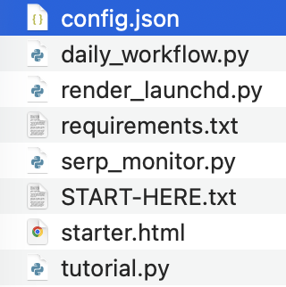
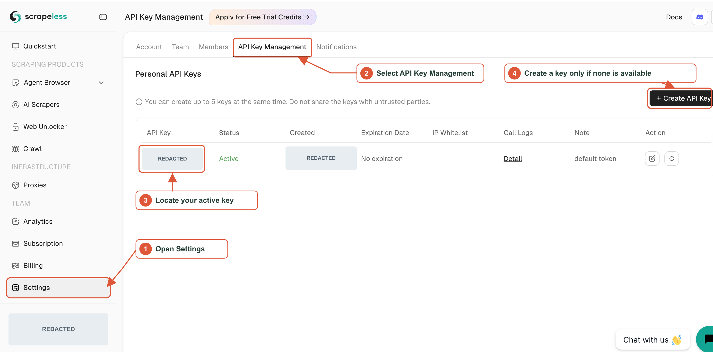
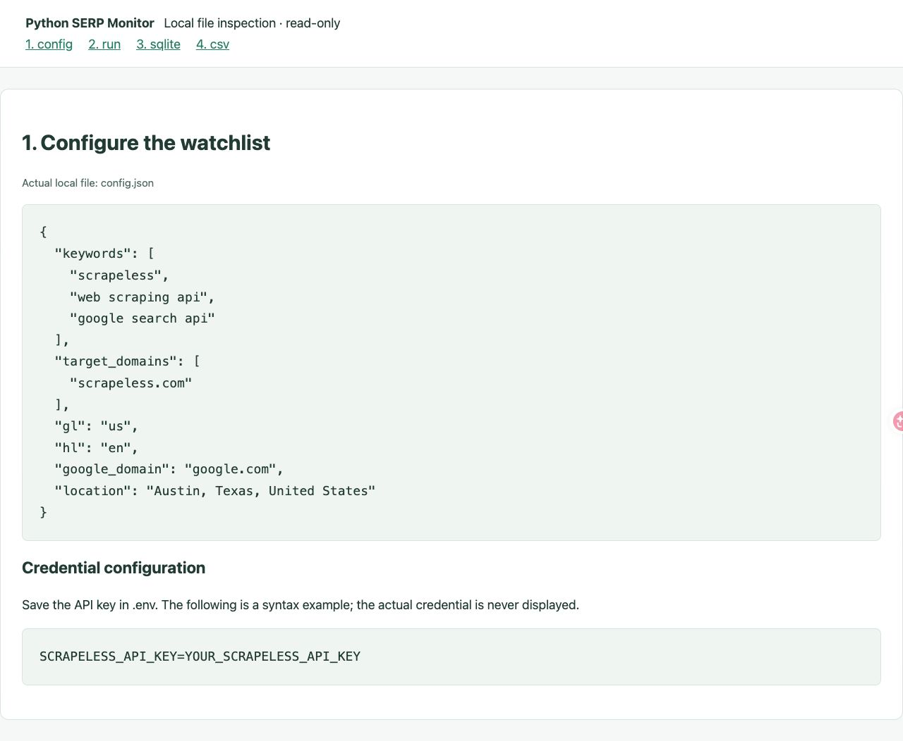
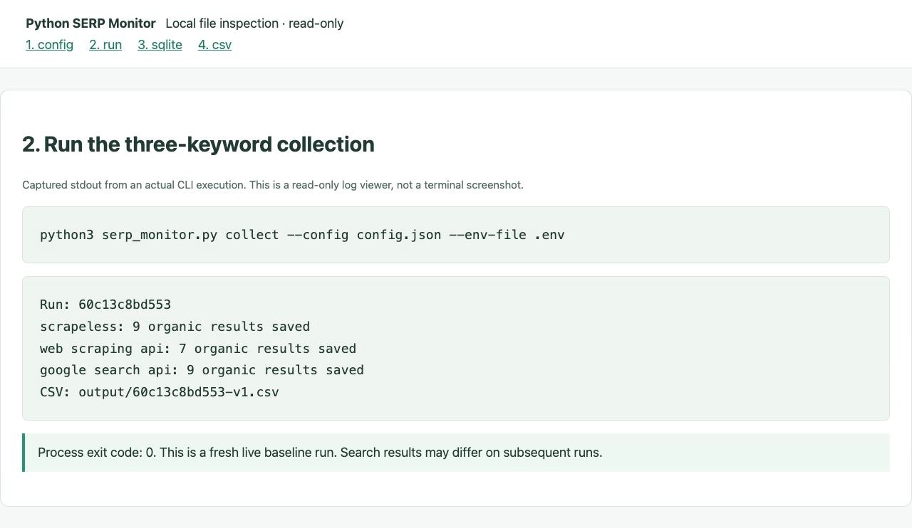
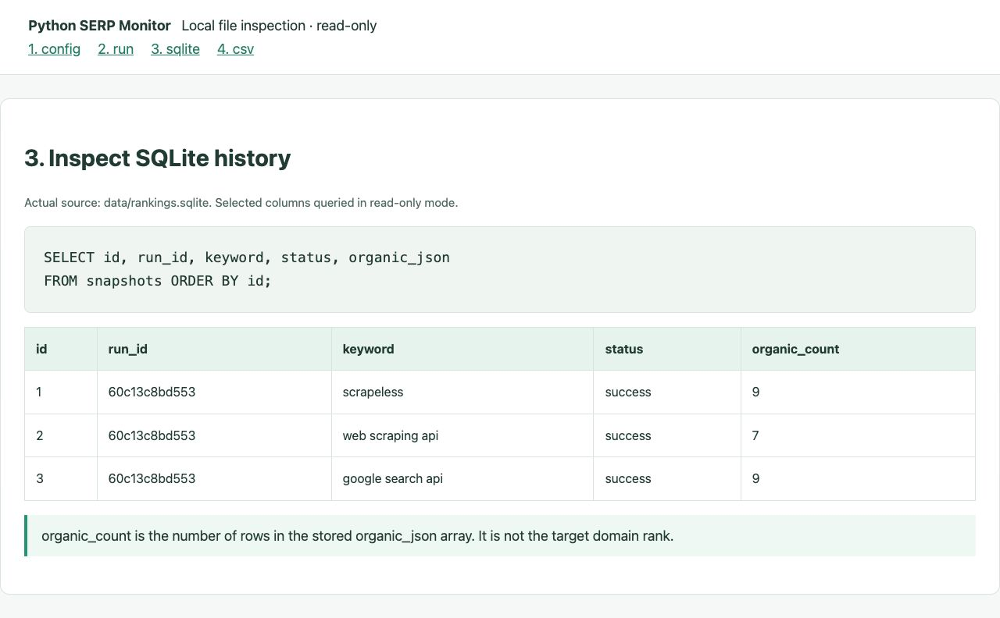
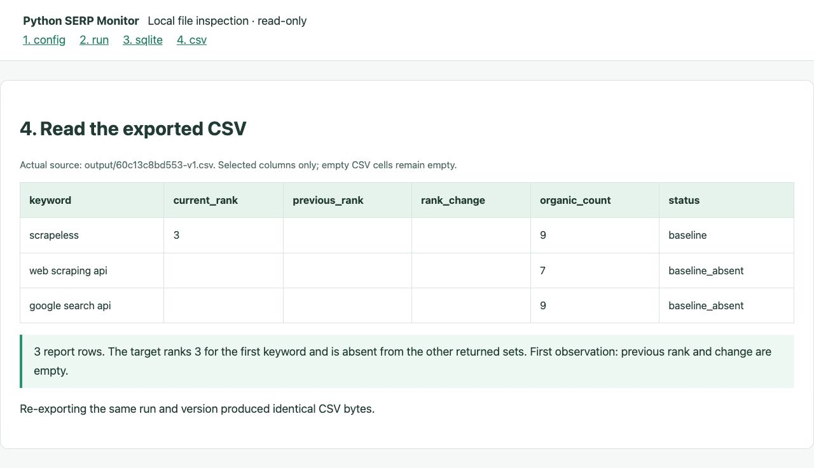

# Build a Python SERP Monitor with SQLite History and CSV Reports

This tutorial starts with the runtime and configuration needed to check three Google keywords for a target domain. You will collect real results, save SQLite history, and export a CSV. The implementation sections explain how response validation, hostname matching and historical comparison make the report interpretable.

## 1. Environment and dependencies

Use Python 3.9 or later on macOS or Linux. This project uses Python's standard library, including urllib, sqlite3, csv and POSIX file locking through fcntl. There are no third-party runtime packages to install and no separate database service. The included requirements.txt documents this. Git and a virtual environment are optional for the ZIP-download workflow.

You also need a terminal, a plain-text editor, a browser, network access to GitHub and Scrapeless, and a Scrapeless account with an active API key and available credits. The following file operations use macOS.

```bash
python3 --version
python3 -c "import sqlite3, ssl, urllib.request, csv, fcntl; print('Required standard-library modules: OK')"
```

Continue when the Python version is at least 3.9 and the imports succeed. The verified environment used Python 3.9.6.

## 2. Download the project

Open the [starter ZIP file page](https://github.com/scrapeless-ai/python-serp-rank-tracker/blob/main/downloads/scrapeless-serp-starter.zip?utm_source=website&utm_medium=referral&utm_campaign=python-serp-monitor-sqlite-csv&utm_content=article-body), click **Download raw file**, and extract it. A Private repository requires an authorized GitHub account.



*Original extracted filenames, cropped to exclude system-language headings, dates and file-type columns.*

In Terminal, type cd followed by a space, drag the extracted scrapeless-serp-starter folder from Finder into Terminal, and press Return. All commands below run from that folder.

```bash
python3 serp_monitor.py --help
```

The help lists collect, history, export and demo. The command-line workflow does not require the optional local browser interface.

## 3. Obtain a key and save the configuration

[Register](https://app.scrapeless.com/passport/register?utm_source=website&utm_medium=referral&utm_campaign=python-serp-monitor-sqlite-csv&utm_content=article-body) or [sign in](https://app.scrapeless.com/passport/login?utm_source=website&utm_medium=referral&utm_campaign=python-serp-monitor-sqlite-csv&utm_content=article-body), then open **Settings > API Key Management**. Obtain your usable active key through the console. Create a key only if none is available. Google Search uses the shared Scrapeless API key.



*1: Open Settings. 2: Select API Key Management. 3: Locate an existing active key. 4: Create a key only if needed. The key, creation-time field and account balance are fully redacted. The image identifies the management controls; it does not imply that clicking a masked row copies its value.*

Create a local key file without overwriting an existing one:

```bash
cp -n .env.example .env
chmod 600 .env
```

On macOS, run `open -e .env`; on Linux, use a plain-text editor. Replace the placeholder, save as .env rather than .env.txt, and close the editor:

```dotenv
SCRAPELESS_API_KEY=YOUR_SCRAPELESS_API_KEY
```

Keep the real value local. An existing SCRAPELESS_API_KEY environment variable takes precedence over .env.

Open config.json with `open -e config.json` on macOS, or your Linux editor. Save the following without changing the filename:

```json
{
  "keywords": ["scrapeless", "web scraping api", "google search api"],
  "target_domains": ["scrapeless.com"],
  "gl": "us",
  "hl": "en",
  "google_domain": "google.com",
  "location": "Austin, Texas, United States"
}
```



*Read-only browser inspection of the actual config.json. The key section is a syntax example only; the working credential is never displayed.*

keywords specifies queries; target_domains specifies hostnames to match locally, not a server-side restriction to that site. gl, hl, google_domain and location select country, language, search domain and location. Keep the same search conditions for later comparisons. The collector fixes desktop and start 0; it does not automatically fetch subsequent pages.

## 4. Run the three-keyword collection

```bash
python3 serp_monitor.py collect --config config.json --env-file .env
```

This submits real searches using your account credits. Wait for completion rather than repeatedly starting new collections. Run 60c13c8bd553 on October 29, 2026 completed with exit code 0:

```text
Run: 60c13c8bd553
scrapeless: 9 organic results saved
web scraping api: 7 organic results saved
google search api: 9 organic results saved
CSV: output/60c13c8bd553-v1.csv
```



*Read-only browser view of stdout retained from the actual command, not a native-terminal screenshot.*

History is saved in data/rankings.sqlite; the report is saved in `output/<run-id>-v1.csv`. Your ID, ranks and returned counts may differ.

## 5. Understand the request and ranking logic

### Keep the search conditions fixed

A rank is meaningful only within a particular search context. A query in one country or language should not be compared with a query in another context. The example sends this request body to `POST /api/v1/scraper/request`:

```json
{
  "actor": "scraper.google.search",
  "input": {
    "q": "scrapeless",
    "gl": "us",
    "hl": "en",
    "google_domain": "google.com",
    "location": "Austin, Texas, United States",
    "start": 0,
    "device": "desktop"
  }
}
```

The client supplies `x-api-token` from your private environment or `.env`; it is not part of this body. `start: 0` selects the first returned organic page, and `device` keeps the desktop context explicit. The request does not set `num`, so the report records the actual result count instead of assuming ten entries.

`scope_key()` hashes a sorted representation of these inputs. The collector uses that key, together with live/demo mode, to identify the correct history series. Changing the location or keyword therefore starts a separate comparison context rather than producing an artificial ranking jump. Target domains are matched against the same returned search response, so adding a target domain does not require another search for that keyword.

A completed search returns HTTP 200. HTTP 201 provides a `taskId`; the collector saves that ID before polling the existing task. A timeout does not trigger a blind repeat of the search POST. This matters because losing the response to a paid request is different from knowing that the request was never submitted.

### Match the destination hostname, not text inside the URL

A page title can mention your website without belonging to it. A URL can also contain your domain inside an unrelated path. The monitor parses the destination hostname and accepts only an exact match or a subdomain. For `example.com`, it accepts `www.example.com` and rejects `notexample.com` or `example.com.other.org`.

You can check the rule locally from the project folder:

```python
from serp_monitor import best_match

rows = [
    {"position": 1, "link": "https://example.com.other.org/page"},
    {"position": 3, "link": "https://www.example.com/page"},
]
match = best_match(rows, "example.com")
print(match["position"])
```

This hand-written matching example prints `3` and makes no API call. When several returned URLs belong to the configured domain, the lowest returned organic position wins. The monitor excludes ads, map results and other result types from this calculation; it is not a blended position across the entire Google page.

Some Google responses contain `/goto` or `/url` links instead of an absolute destination. Rejecting every relative link would lose an otherwise usable keyword observation. The collector decodes an explicit destination locally, or reads a bounded Google redirect's `Location` header when the link uses an opaque token. That lookup uses a separate opener with no Scrapeless key or cookies and does not visit the destination website. An unresolved link remains a collection error; it is not silently removed to make the batch look successful.


## 6. Inspect SQLite history

### Store observations and reports separately in SQLite

SQLite keeps the history in `data/rankings.sqlite`, without a separate database service. The main tables have distinct jobs:

| Table | What it keeps | Why it is separate |
| --- | --- | --- |
| `runs` | Batch ID, mode, configuration and overall state | Identifies one deliberate collection |
| `snapshots` | Keyword inputs, task ID, response, validated organic rows and request timing | Preserves each observation and enough state to resume saved tasks |
| `report_versions` | Report version, state and completed report rows | Keeps an exported report stable after later history is added |

The database contains more detail than the CSV. Keep it if you want the next collection to have a previous observation. A CSV is a shareable report; it is not a replacement for the saved task and comparison history.

Save the following code as `inspect_history.py` in the project folder, then run `python3 inspect_history.py`. It reads the actual database without submitting a search:

```python
import json
import sqlite3
from pathlib import Path

uri = Path("data/rankings.sqlite").resolve().as_uri() + "?mode=ro"
with sqlite3.connect(uri, uri=True) as db:
    rows = db.execute("""
        SELECT keyword, status, organic_json
        FROM snapshots
        WHERE run_id = (
            SELECT id FROM runs
            WHERE mode = 'live'
            ORDER BY started_at DESC LIMIT 1
        )
        ORDER BY id
    """)
    for keyword, status, organic_json in rows:
        count = len(json.loads(organic_json or "[]"))
        print(keyword, status, count)
```

The actual database from run `60c13c8bd553` prints:

```text
scrapeless success 9
web scraping api success 7
google search api success 9
```

These are saved counts from the October 29 run. Reading them does not submit another search. Your latest run can have different counts.




*Selected fields queried from the actual SQLite database in a read-only browser viewer, not a database application. organic_count is derived from the stored organic array and is not the target domain rank.*

## 7. Read the exported CSV

Open the output folder in Finder and open the generated CSV in your spreadsheet application. Start with keyword, current_rank, previous_rank, rank_change, organic_count and status.



*Read-only browser view of the actual CSV's selected columns, not a spreadsheet application screenshot. Empty cells remain empty.*

| Keyword | Current rank | Returned count | Status |
| --- | --- | --- | --- |
| scrapeless | 3 | 9 | baseline |
| web scraping api | blank | 7 | baseline_absent |
| google search api | blank | 9 | baseline_absent |

The run saved one batch, three successful snapshots and three CSV rows. No previous observation exists in this fresh database, so previous rank and change are blank. The target was absent from the other two returned sets, not assigned rank zero.

```bash
python3 serp_monitor.py history --db data/rankings.sqlite
python3 serp_monitor.py export --output output/saved-report.csv
```

These commands read local history without submitting searches. Re-exporting run 60c13c8bd553 version 1 produced identical CSV bytes. The [public CSV sample](../examples/live-current.csv) generalizes matching URL paths; rank, count, state and request-timing fields are preserved.

## 8. Compare a later observation

Return to the same folder and deliberately collect again at your next observation time, retaining the configuration and database. This is a new paid collection, not a required extra step to inspect the baseline.

### Choose a valid comparison before calculating a change

The first usable observation is a baseline. A later observation can be compared only with a successful earlier result under the same search conditions and mode. The collector checks that the earlier response arrived no later than the current request was submitted. It also checks for overlapping or unfinished observations that make their collection order uncertain.

That timing check avoids treating retrieval order as search collection order. If two requests overlap, or older history lacks reliable request timing, the current position is kept but the report uses `not_comparable` rather than inventing an increase or decrease. These timestamps describe the client's request interval; they are not a claim about the provider's exact collection instant.

When both comparable observations contain the target, `rank_change = previous_rank - current_rank`: moving from 5 to 3 gives `+2`. A blank current rank means the domain was not found in the returned set, not position zero. An entirely empty organic array is held as `empty_unverified` and excluded from the baseline. HTTP failures and unresolved URLs are also kept out of absence-based ranking conclusions.

### Export the saved version instead of recalculating it

After collection, the program freezes the selected baseline and stores the report rows as a numbered version. Later searches cannot rewrite that version. This also freezes the first-run no-baseline decision; an older task retrieved later does not silently change an already saved CSV.

The CSV uses UTF-8 with a byte-order mark for spreadsheet compatibility, leaves unavailable numeric comparisons blank, and escapes formula-like text cells. Its file name includes the run ID and report version. An explicit output path can be overwritten when you choose it, while the saved database version remains available.

To re-export an existing version, replace `YOUR_RUN_ID` with the run ID from your result:

```bash
python3 serp_monitor.py export --run-id YOUR_RUN_ID --version 1 --output output/saved-v1.csv
```

This reads the stored report and makes no API calls. The writer creates a temporary CSV and replaces the requested file only after writing completes, so a reader is less likely to encounter a half-written report.


## 9. Troubleshooting and optional local interface

| Symptom | Action |
| --- | --- |
| Program or configuration not found | Run commands from the extracted project folder |
| Missing or invalid key | Check the placeholder, exact filename and environment-variable precedence |
| Insufficient credits or rate limiting | Resolve the account or frequency issue before submitting another collection |
| Pending task | Resume the saved run rather than repeatedly creating new searches |
| Blank rank | Check the target hostname and returned coverage |
| No numeric change | Check whether this is a baseline or the observations are not comparable |
| Busy database | Wait for the other collector; do not delete its lock file |

`collect --resume YOUR_RUN_ID` skips successful keywords and polls saved tasks. It may submit never-sent keywords, so recovery is not a guarantee of zero new searches. See the [operations guide](operations.md).

If you prefer a form, run `python3 tutorial.py` **on your own computer, from the project folder**. Keep it running and open the loopback address printed in Terminal (default `http://127.0.0.1:8791/`). This is a local interface, not a hosted website or shared public link. It is unavailable until your local process starts. Both interfaces use the same collector and history; completing this tutorial does not require repeating collection through the form.

Keep .env and the working database private. The example is intended for a small local watchlist and a first baseline; it does not establish a multi-day trend or permanent schedule reliability.

## Resources

- [Repository and README](https://github.com/scrapeless-ai/python-serp-rank-tracker?utm_source=website&utm_medium=referral&utm_campaign=python-serp-monitor-sqlite-csv&utm_content=article-body)
- [Official Google Search quickstart](https://docs.scrapeless.com/en/docs/scraping-api/google-search/quickstart/?utm_source=website&utm_medium=referral&utm_campaign=python-serp-monitor-sqlite-csv&utm_content=article-body)
- [CLI reference](cli.md)
- [CSV field reference](output.md)
